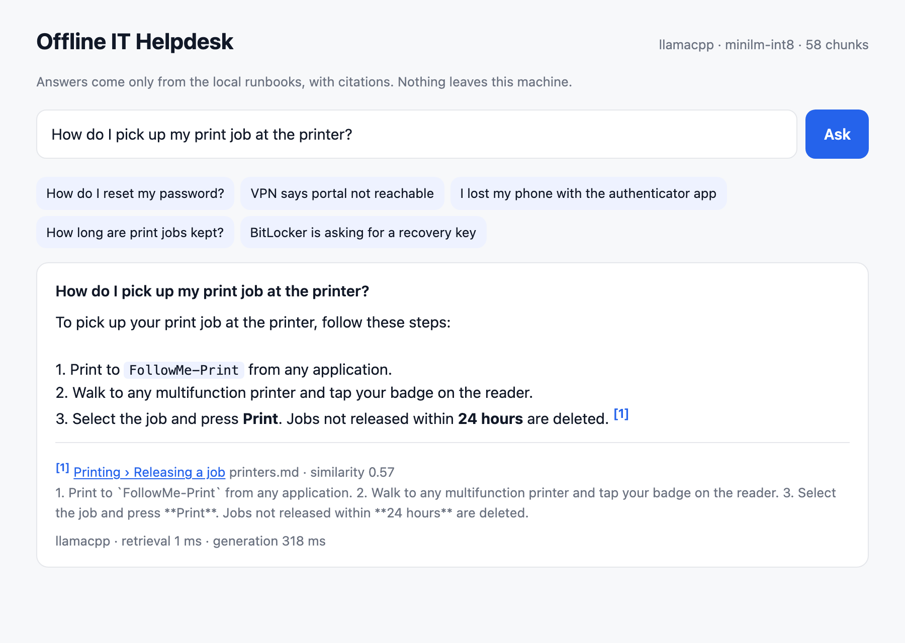
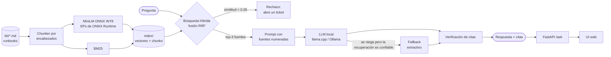

# offline-it-helpdesk

[](https://github.com/RobiiAragon/offline-it-helpdesk/actions/workflows/ci.yml)


[English](README.md) · **Español**

**Un asistente de helpdesk de TI que corre 100% en tu propia máquina: sin API en la nube y
sin que ningún dato salga del equipo.** Responde preguntas de los empleados con base en tus
runbooks, **cita la sección exacta** que usó, se niega a contestar lo que los runbooks no
cubren e incluye una suite de evaluación que mide todo eso.



- **Recuperación híbrida:** embeddings MiniLM en ONNX (INT8, 23 MB) + BM25, combinados con
  reciprocal rank fusion. Los embeddings corren en ONNX Runtime con detección de execution
  providers (CPU, CoreML, QNN, CUDA, NNAPI, XNNPACK).
- **LLM local chico:** llama.cpp (`llama-server`) u Ollama a través de su API compatible con
  OpenAI. Por defecto usa Qwen2.5-1.5B-Instruct Q4_K_M (1.1 GB). Las llamadas HTTP solo usan la
  librería estándar.
- **Respuestas con fundamento:** fuentes numeradas, citas `[n]` verificadas contra lo
  recuperado (las inválidas se marcan), un umbral de similitud que rechaza preguntas fuera de
  alcance y un fallback extractivo para cuando el LLM chico se niega sin razón.
- **FastAPI + UI web:** `POST /ask`, `GET /health`, `GET /kb/{doc}` y una página HTML/JS de
  un solo archivo con tema claro/oscuro. Al dar clic en una cita se ve el runbook original.
- **Evaluación:** 32 preguntas contestables + 8 fuera de alcance. Mide hit@k/MRR de
  recuperación, recall de hechos requeridos, exactitud de citas, rechazos correctos e
  incorrectos, latencia y tokens/s.
- **Base de conocimiento de ejemplo:** 15 runbooks originales de una empresa ficticia
  (contraseñas, MFA, VPN, Wi-Fi, impresión, correo, phishing, BitLocker, onboarding…), todo con
  dominios `example.com`.
- **Funciona en Android:** el tokenizer WordPiece está escrito en Python puro (verificado
  idéntico al de HuggingFace en toda la KB), así que no depende de Rust y todo el pipeline
  corre en Termux.

## Arquitectura



## Inicio rápido

```bash
git clone https://github.com/RobiiAragon/offline-it-helpdesk && cd offline-it-helpdesk
python3.12 -m venv .venv && source .venv/bin/activate
pip install -e ".[dev]"

helpdesk download                # MiniLM ONNX INT8 + vocab (23 MB, verificado con SHA-256)
helpdesk index                   # 58 chunks en ~0.2 s

brew install llama.cpp
scripts/start_llm.sh             # descarga Qwen2.5-1.5B Q4_K_M una vez (1.1 GB), sirve en :8080

helpdesk ask "Mi cuenta está bloqueada, ¿qué hago?"
helpdesk serve                   # UI en http://127.0.0.1:8000, docs de la API en /docs
helpdesk eval
```

¿Sin LLM? `helpdesk ask --llm extractive "..."` cita textualmente los mejores pasajes. Es
el modo que usa el CI. Con Ollama: `ollama pull qwen2.5:1.5b && helpdesk serve --llm ollama
--llm-model qwen2.5:1.5b`. Para usar tus propios documentos:
`helpdesk index --kb-dir ruta/a/docs`.

> Nota: el modelo de embeddings (all-MiniLM-L6-v2) es solo para inglés, así que las preguntas
> en español sobre runbooks en inglés recuperan peor. Los embeddings multilingües están en el
> roadmap.

## Resultados medidos en mi Mac

**Hardware:** MacBook Pro (Mac17,6), Apple **M5 Max**, 48 GB RAM, macOS 27.2.
**Software:** Python 3.12.16, onnxruntime 1.32.0 (EP CPU para embeddings), llama.cpp
`llama-server` 0.7.0 (Homebrew build 11669, Metal), temperatura 0, top_k = 3. Los resultados
por pregunta están en [`eval/results/`](eval/results/).

| Configuración | Hit@1 | Totalmente correcta | Recall de hechos | Cita el doc esperado | Rechazos falsos | Fuera de alcance rechazadas | Generación p50 / p95 | Velocidad |
|---|---:|---:|---:|---:|---:|---:|---:|---:|
| MiniLM-INT8 + **Qwen2.5-1.5B** Q4_K_M (default) | 96.9% | **84.4%** | 85.9% | 96.9% | 0.0% | 100% | 97 / 369 ms | 269 tok/s |
| MiniLM-INT8 + Qwen2.5-0.5B Q4_K_M | 96.9% | 62.5% | 64.1% | 81.2% | 0.0% | 100% | 47 / 242 ms | 344 tok/s |
| MiniLM-INT8 + extractivo (sin LLM) | 96.9% | 96.9% | 96.9% | 100% | 0.0% | 100% | < 1 ms | n/a |
| MiniLM-FP32 (90 MB) + extractivo | 96.9% | 96.9% | 96.9% | 100% | 0.0% | 100% | < 1 ms | n/a |
| Embedder hashing (sin modelo) + extractivo | 75.0% | 68.8% | 70.3% | 89.7% | 9.4% | 25% | < 1 ms | n/a |

*"Totalmente correcta" significa que la respuesta contiene todos los hechos requeridos (p. ej.
"10" intentos y "30 minutes" en la pregunta de bloqueo). La recuperación, incluyendo el
embedding de la pregunta, tarda ~1 ms. En tres corridas de la misma configuración las métricas
de calidad salieron idénticas y la generación p50 varió entre 92 y 122 ms.*

**Ablación (Qwen2.5-1.5B, las mismas 40 preguntas):**

| top_k | Fallback extractivo | Totalmente correcta | Rechazos falsos | Cita el doc esperado |
|---:|:---:|---:|---:|---:|
| 4 | no | 75.0% | 9.4% | 93.1% |
| 3 | no | 71.9% | 12.5% | 96.4% |
| 4 | sí | 84.4% | 0.0% | 93.8% |
| **3** | **sí** | **84.4%** | **0.0%** | **96.9%** |

### Lo que aprendí

1. **El cuello de botella no es la recuperación, es el LLM de 1.5B.** La sección correcta
   está en el top 3 en el 100% de las preguntas y en el lugar 1 en el 96.9%, pero el LLM solo
   incluye todos los hechos en el 84.4% de las respuestas. Cuando falla, casi siempre es porque
   cita la fuente vecina o se niega a contestar.
2. **Los embeddings INT8 no cuestan nada aquí.** MiniLM INT8 (23 MB) recupera igual que FP32
   (90 MB) en esta KB.
3. **Los LLMs chicos se niegan a contestar preguntas que sí tienen respuesta.** Sin el
   fallback, Qwen 1.5B rechazó de 3 (top_k = 4) a 4 (top_k = 3) de 32 aunque la recuperación había encontrado la sección
   correcta. Usar el pasaje textual cuando el LLM se niega pero la similitud es ≥ 0.5 eliminó
   todos los rechazos falsos y se siguió rechazando el 100% de las preguntas fuera de alcance.
4. **0.5B vs 1.5B:** el modelo de 0.5B (el que cabe bien en la tablet) es 1.3× más rápido por
   token pero pierde 22 puntos de exactitud, y el fallback se activa en el 44% de las
   preguntas. En una CPU de celular el modo extractivo es un default razonable y el LLM es un
   extra.
5. **Los modelos chicos olvidan las marcas `[n]`.** En ese caso la UI muestra las secciones
   recuperadas como "fuentes consultadas (el modelo no las citó explícitamente)" en vez de
   inventar citas.

Los parámetros (top_k = 3, umbral del fallback 0.5) se eligieron con este mismo conjunto de
preguntas y todavía no hay un conjunto separado para validar, así que toma los números como
indicativos.

## Correrlo en la Galaxy Tab S9 Ultra (Termux)

```bash
pkg install -y git
git clone https://github.com/RobiiAragon/offline-it-helpdesk && cd offline-it-helpdesk
bash scripts/android_termux_check.sh
```

El script instala los paquetes precompilados de Termux (`python-numpy`, `python-onnxruntime`,
`llama-cpp`) y este paquete con `--no-deps`. Descarga MiniLM (23 MB) y Qwen2.5-0.5B (0.5 GB),
indexa con el EP XNNPACK, levanta `llama-server` en CPU, corre la evaluación completa y escribe
`eval/results/android-<modelo>-qwen2.5-0.5b.json`. Opciones: `MODEL=qwen2.5-1.5b`, `THREADS=8`,
`PROVIDERS=cpu`. En Termux no se instala FastAPI porque `pydantic-core` no tiene wheel para
Android; la CLI cubre `ask` y `eval`.

## Docker

```bash
docker compose up --build        # API + UI en http://127.0.0.1:8000, modo extractivo
```

La imagen trae el embedder de 23 MB y el índice, corre con un usuario sin privilegios y no
necesita red al ejecutarse: el CI la construye y revisa que conteste con `--network none`. El
puerto solo se publica en `127.0.0.1`. Para agregar un LLM local, pon el GGUF en `./models` y
corre `HELPDESK_LLM=llamacpp docker compose --profile llm up`, que levanta la imagen del
servidor de llama.cpp en CPU. En Mac, Docker no puede usar Metal; para que sea rápido corre
`scripts/start_llm.sh` nativo y usa `HELPDESK_LLM=llamacpp
HELPDESK_LLM_URL=http://host.docker.internal:8080/v1`. Los números de arriba se midieron de
forma nativa, no en Docker.

## Desarrollo

```bash
pip install -e ".[dev]"
ruff check . && ruff format --check . && pytest -q   # 25 pruebas, < 2 s, sin descargas
scripts/mac_check.sh                                  # lint, pruebas, índice, LLM, eval y API
```

El CI (ubuntu + macOS, Python 3.11–3.13) corre lint y pruebas, descarga el embedder ONNX real
y **falla si el hit@k de recuperación baja de 95% o si los rechazos fuera de alcance bajan de 85%**.
Otro job construye la imagen de Docker y prueba `/ask`, incluso sin red.

Todo escucha en `127.0.0.1` por defecto. Si lo expones en una red, ponlo detrás de
autenticación, porque ni llama-server ni esta API tienen API key.

## Roadmap

- [ ] Resultados de la tablet (Termux, Snapdragon 8 Gen 2) con 0.5B y 1.5B
- [ ] Conjunto de preguntas separado para validación y verificación de fidelidad sin LLM (NLI en ONNX)
- [ ] Embeddings multilingües (e5-small / bge-m3) para preguntas en español
- [ ] Re-ranking con un cross-encoder chico en la NPU vía el EP QNN de ONNX Runtime
- [ ] Convertir una pregunta rechazada en un ticket pre-llenado para la Service Desk
- [ ] Respuestas en streaming en la UI

## Licencia

MIT © Jesús Aragón. Los runbooks de `kb/` son originales y también MIT. Modelos:
all-MiniLM-L6-v2 (Apache-2.0) y Qwen2.5-Instruct GGUF (Apache-2.0), descargados bajo demanda
y no redistribuidos.
