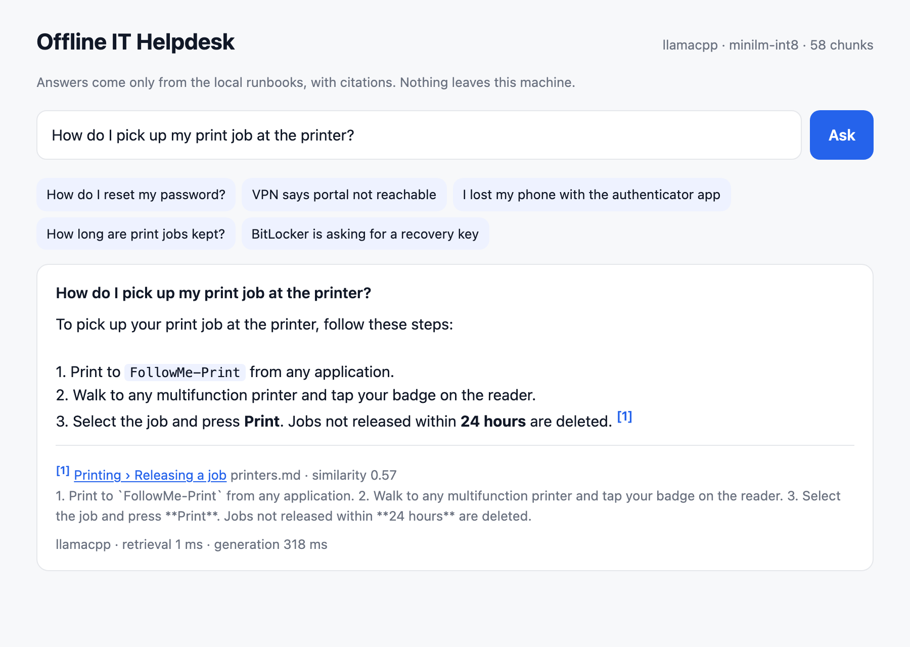
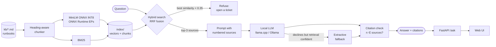

# offline-it-helpdesk

[](https://github.com/RobiiAragon/offline-it-helpdesk/actions/workflows/ci.yml)


**English** · [Español](README.es.md)

**An IT helpdesk assistant that runs 100% on your own machine: no cloud API, no data leaving
the device.** It answers employee questions from your runbooks, **cites the exact section**
it used, refuses questions the runbooks don't cover, and comes with an evaluation suite
that measures all of that.



- **Hybrid retrieval:** ONNX MiniLM embeddings (INT8, 23 MB) plus BM25, fused with
  reciprocal rank fusion. Embeddings run on ONNX Runtime with execution-provider detection
  (CPU, CoreML, QNN, CUDA, NNAPI, XNNPACK).
- **Small local LLM:** llama.cpp (`llama-server`) or Ollama through their OpenAI-compatible
  API, using Qwen2.5-1.5B-Instruct Q4_K_M (1.1 GB) by default. HTTP uses only the standard library.
- **Grounded answers:** numbered sources, `[n]` citations checked against what was retrieved
  (invalid ones are flagged), a similarity threshold that refuses out-of-scope questions, and
  an extractive fallback when the small LLM wrongly declines.
- **FastAPI + web UI:** `POST /ask`, `GET /health`, `GET /kb/{doc}`, and a single-file
  HTML/JS page with light/dark themes. You can click a citation to read the source runbook.
- **Evaluation:** 32 answerable and 8 out-of-scope questions, measuring retrieval hit@k/MRR,
  required-fact recall, citation accuracy, false and correct refusals, and latency/tokens per second.
- **Sample knowledge base:** 15 original runbooks for a fictional company (passwords, MFA,
  VPN, Wi-Fi, printing, email, phishing, BitLocker, onboarding…), all `example.com`.
- **Runs on Android:** a pure-Python WordPiece tokenizer (verified identical to HuggingFace's
  on the whole KB) means there's no Rust dependency, so the whole pipeline runs in Termux.

## Architecture



## Quickstart

```bash
git clone https://github.com/RobiiAragon/offline-it-helpdesk && cd offline-it-helpdesk
python3.12 -m venv .venv && source .venv/bin/activate
pip install -e ".[dev]"

helpdesk download                # MiniLM ONNX INT8 + vocab (23 MB, SHA-256 verified)
helpdesk index                   # chunk + embed kb/ (58 chunks in ~0.2 s)

brew install llama.cpp           # or: Ollama, see below
scripts/start_llm.sh             # downloads Qwen2.5-1.5B Q4_K_M once (1.1 GB), serves :8080

helpdesk ask "My account is locked, what do I do?"
helpdesk serve                   # web UI at http://127.0.0.1:8000, API docs at /docs
helpdesk eval                    # full evaluation
```

No LLM? `helpdesk ask --llm extractive "..."` quotes the best passages verbatim with
citations. That mode is deterministic, instant, and what CI uses.

**Ollama instead of llama.cpp:**
`ollama pull qwen2.5:1.5b && helpdesk serve --llm ollama --llm-model qwen2.5:1.5b`.

**Use your own runbooks:** drop Markdown files into a folder and run
`helpdesk index --kb-dir path/to/docs`. `#` is the document title, and `##`/`###` sections
become citable chunks.

| Command | Purpose |
|---|---|
| `download` | Fetch the embedding model (`--embedder minilm-int8\|minilm-fp32`) and optionally a GGUF (`--llm qwen2.5-0.5b`) |
| `index` | Chunk + embed the KB (`--kb-dir`, `--providers cpu,coreml,…`) |
| `ask` | One question (`--json` for the full record incl. retrieved chunks) |
| `serve` | FastAPI + web UI (`--host`, `--port`) |
| `eval` | Run `eval/questions.jsonl` and write a JSON report (`--out`) |
| `doctor` | Check ONNX Runtime EPs and that the LLM server is reachable |

Settings can also come from environment variables: `HELPDESK_LLM`, `HELPDESK_LLM_URL`,
`HELPDESK_TOP_K`, `HELPDESK_MIN_SCORE`, `HELPDESK_FALLBACK_SCORE`, `HELPDESK_PROVIDERS`, …
Flags win over environment variables (`--top-k`, `--min-score`, `--max-tokens`; `--min-score 0`
really disables the refusal guard).

## Results: measured on my Mac

**Hardware:** MacBook Pro (Mac17,6), Apple **M5 Max**, 48 GB RAM, macOS 27.2.
**Software:** Python 3.12.16, onnxruntime 1.32.0 (CPU EP for embeddings), llama.cpp
`llama-server` 0.7.0 (Homebrew build 11669, Metal), temperature 0, top_k = 3. Raw per-question
results are in [`eval/results/`](eval/results/).

| Configuration | Retrieval hit@1 | Fully correct | Fact recall | Cites expected doc | False refusals | Out-of-scope refused | Generation p50 / p95 | Speed |
|---|---:|---:|---:|---:|---:|---:|---:|---:|
| MiniLM-INT8 + **Qwen2.5-1.5B** Q4_K_M (default) | 96.9% | **84.4%** | 85.9% | 96.9% | 0.0% | 100% | 97 / 369 ms | 269 tok/s |
| MiniLM-INT8 + Qwen2.5-0.5B Q4_K_M | 96.9% | 62.5% | 64.1% | 81.2% | 0.0% | 100% | 47 / 242 ms | 344 tok/s |
| MiniLM-INT8 + extractive (no LLM) | 96.9% | 96.9% | 96.9% | 100% | 0.0% | 100% | < 1 ms | n/a |
| MiniLM-FP32 (90 MB) + extractive | 96.9% | 96.9% | 96.9% | 100% | 0.0% | 100% | < 1 ms | n/a |
| Hashing embedder (no model) + extractive | 75.0% | 68.8% | 70.3% | 89.7% | 9.4% | 25% | < 1 ms | n/a |

*"Fully correct" means the answer contains every required fact for that question (e.g. "10"
attempts and "30 minutes" for the lockout question). Retrieval, including embedding the query,
takes about 1 ms. The eval set covers all 15 runbooks. Over three runs of the same configuration,
the quality metrics were identical and generation p50 ranged 92–122 ms, depending on what else
the Mac was doing.*

**Ablation (Qwen2.5-1.5B, same 40 questions):**

| top_k | Extractive fallback | Fully correct | False refusals | Cites expected doc |
|---:|:---:|---:|---:|---:|
| 4 | off | 75.0% | 9.4% | 93.1% |
| 3 | off | 71.9% | 12.5% | 96.4% |
| 4 | on | 84.4% | 0.0% | 93.8% |
| **3** | **on** | **84.4%** | **0.0%** | **96.9%** |

### What I learned

1. **Retrieval isn't the bottleneck; the 1.5B LLM is.** The right section is in the top 3
   for 100% of questions and at rank 1 for 96.9%, yet the LLM includes every required fact in
   only 84.4% of answers. When it fails, it's usually by quoting the neighboring source (VPN
   "Connecting" instead of "Troubleshooting") or by declining.
2. **INT8 embeddings are free here.** The 23 MB INT8 MiniLM retrieves exactly as well as the
   90 MB FP32 model on this KB.
3. **Small LLMs decline answerable questions.** Without the fallback, Qwen 1.5B refused 3/32 (top_k = 4)
   to 4/32 (top_k = 3) answerable questions even though retrieval had found the right section. Falling back to the
   verbatim passage when the LLM declines but similarity is ≥ 0.5 removed every false refusal
   and kept 100% of out-of-scope questions refused.
4. **0.5B vs 1.5B:** the 0.5B model (the tablet-sized one) is 1.3× faster per token but loses
   22 points of correctness, and the fallback fires on 44% of questions. On a phone-class CPU,
   the extractive mode is a reasonable default and the LLM a nice-to-have.
5. **Small models forget the `[n]` markers.** The UI then lists the retrieved sections as
   "Sources consulted (the model did not cite them explicitly)" rather than inventing citations.

The settings above (top_k = 3, fallback threshold 0.5) were picked on this same question set,
and there's no separate held-out set yet. Treat the numbers as indicative.

## Run it on the Galaxy Tab S9 Ultra (Termux)

```bash
pkg install -y git
git clone https://github.com/RobiiAragon/offline-it-helpdesk && cd offline-it-helpdesk
bash scripts/android_termux_check.sh
```

The script installs Termux's prebuilt `python-numpy`, `python-onnxruntime` and `llama-cpp`,
installs this package with `--no-deps`, downloads MiniLM (23 MB) and Qwen2.5-0.5B (0.5 GB),
indexes with the XNNPACK EP, starts `llama-server` on the CPU, runs the full evaluation
and writes `eval/results/android-<model>-qwen2.5-0.5b.json`. Options: `MODEL=qwen2.5-1.5b`,
`THREADS=8`, `PROVIDERS=cpu`. FastAPI is skipped on Termux because `pydantic-core` has no
Android wheel; the CLI covers `ask` and `eval`.

## Docker

```bash
docker compose up --build        # API + UI on http://127.0.0.1:8000, extractive mode
```

The image bakes in the 23 MB embedder and the index, runs as a non-root user and needs no
network at runtime: CI builds it and checks that it answers with `--network none`. The
port is published on `127.0.0.1` only. To add a local LLM, put the GGUF in `./models`
and run `HELPDESK_LLM=llamacpp docker compose --profile llm up`, which starts llama.cpp's
server image on the CPU. On a Mac, Docker can't use Metal, so for speed run
`scripts/start_llm.sh` natively and set `HELPDESK_LLM=llamacpp
HELPDESK_LLM_URL=http://host.docker.internal:8080/v1`. The numbers above were measured
natively, not in Docker.

## API

```bash
curl -s localhost:8000/ask -H 'Content-Type: application/json' \
     -d '{"question": "How long are print jobs kept?"}'
```

```json
{
  "answer": "Print jobs not released within 24 hours are deleted. [1]",
  "citations": [{"n": 1, "doc": "printers.md", "title": "Printing",
                 "section": "Releasing a job", "snippet": "1. Print to …", "dense": 0.64}],
  "refused": false, "reason": "answered", "backend": "llamacpp",
  "retrieve_ms": 1.0, "generate_ms": 118.0, "invalid_citations": [], "retrieved": ["…"]
}
```

Everything binds to `127.0.0.1` by default. If you expose it on a network, put it behind
authentication: llama-server and this API have no API key.

## Development

```bash
pip install -e ".[dev]"
ruff check . && ruff format --check . && pytest -q   # 25 tests, < 2 s, no downloads
scripts/mac_check.sh                                  # lint, tests, index, LLM, eval, API smoke test
```

CI (ubuntu + macOS, Python 3.11–3.13) runs lint and the tests, then downloads the real
23 MB ONNX embedder and **fails if retrieval hit@k drops below 95% or out-of-scope
refusals drop below 85%**. A second job builds the Docker image and smoke-tests `/ask`,
including with networking disabled.

```
src/offline_helpdesk/
  tokenizer.py   pure-Python BERT WordPiece (matches HF tokenizers, no Rust wheel)
  embedder.py    ONNX MiniLM (mean-pool + L2) and a hashing fallback
  chunker.py     heading-aware Markdown chunking with provenance
  bm25.py        Okapi BM25
  index.py       hybrid search with reciprocal rank fusion; save/load
  llm.py         llama.cpp / Ollama (OpenAI-compatible, stdlib HTTP) + extractive
  rag.py         retrieve -> guard -> generate -> fallback -> citation check
  evaluate.py    metrics: hit@k, MRR, fact recall, citations, refusals, latency
  api.py, web/   FastAPI service and single-file UI
```

## Roadmap

- [ ] Tablet results (Termux, Snapdragon 8 Gen 2) for 0.5B and 1.5B in this README
- [ ] Held-out question set and an LLM-free answer-faithfulness check (NLI cross-encoder in ONNX)
- [ ] Multilingual embeddings (e5-small / bge-m3) so Spanish questions work over English runbooks
- [ ] Re-ranking with a small cross-encoder on the NPU via the ONNX Runtime QNN EP
- [ ] Ticket hand-off: turn a refused question into a pre-filled ticket for the Service Desk
- [ ] Streaming responses in the UI

## License

MIT © Jesús Aragón. The sample runbooks in `kb/` are original and MIT-licensed too. Models:
all-MiniLM-L6-v2 (Apache-2.0) and Qwen2.5-Instruct GGUF (Apache-2.0), downloaded on demand
and not redistributed.
